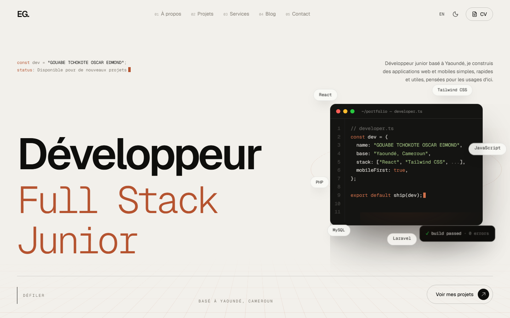
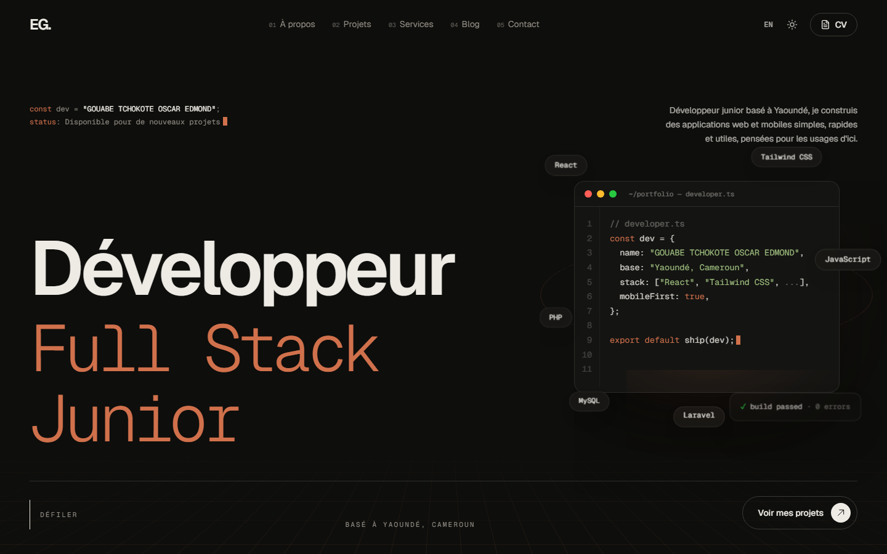
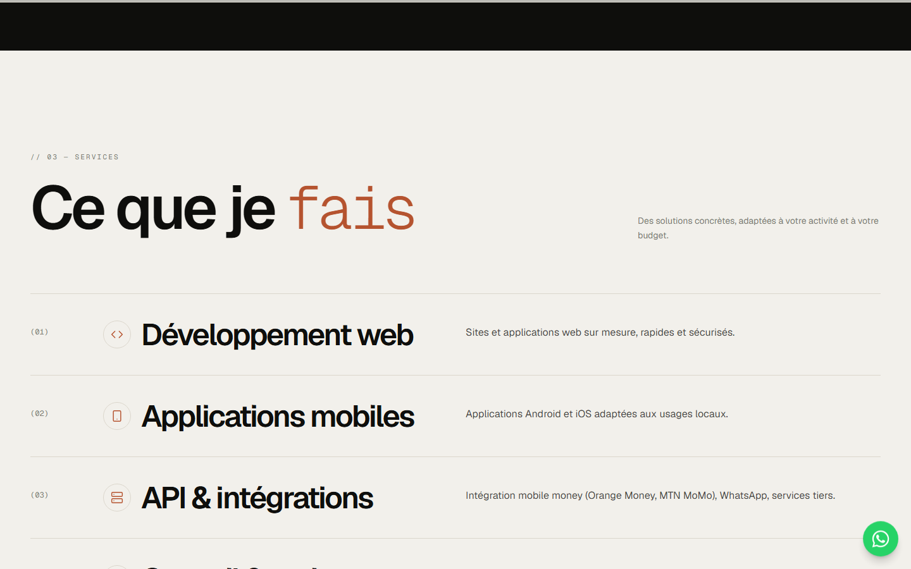
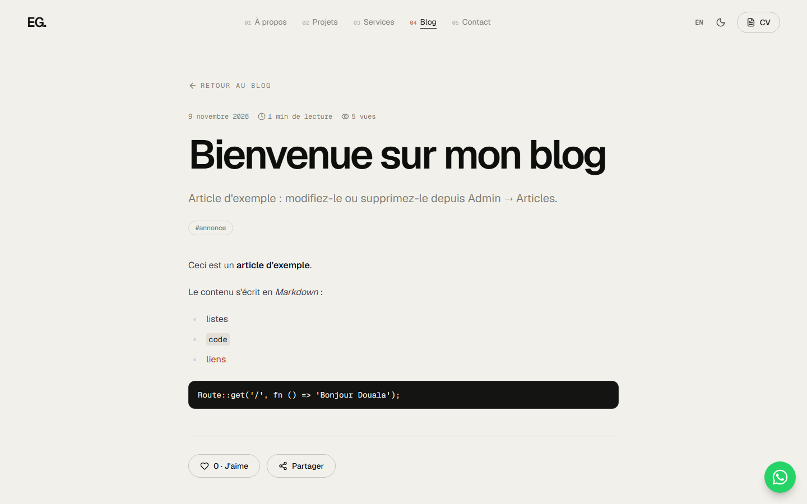
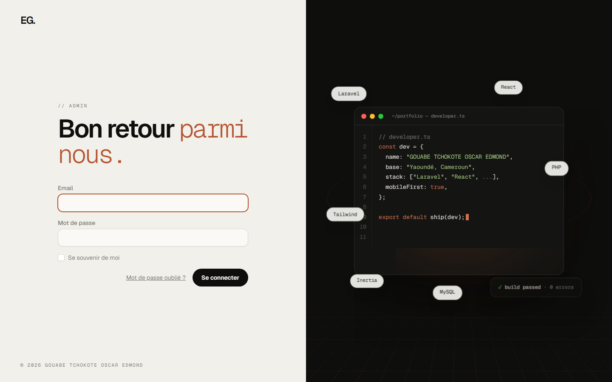

<div align="center">

# Oscar Edmond Gouabe Tchokote — Portfolio

**Développeur Full Stack Junior · Yaoundé, Cameroun**

Portfolio one-page bilingue (FR/EN) avec back-office complet, animations éditoriales et effets 3D.




</div>

## Aperçu

| Mode sombre | Services |
|---|---|
|  |  |
| **Article de blog** | **Connexion à l'administration** |
|  |  |

## Fonctionnalités

### Site public

- **One-page** : à propos, projets, services, blog et contact sur une seule page. Le menu fait défiler jusqu'à chaque section et surligne celle qui est à l'écran.
- **Projets** : défilement horizontal piloté par le scroll sur ordinateur, carrousel tactile sur mobile, filtre par catégorie, page détaillée avec galerie et visionneuse.
- **Services, packs et estimateur de devis** en FCFA. Le choix d'un pack ou d'une estimation pré-remplit le formulaire de contact.
- **Blog** : recherche, tags, temps de lecture, likes, partage, commentaires modérés et barre de progression de lecture.
- **Contact** : formulaire avec pièce jointe (2 Mo maximum, contrôlée avant l'envoi), anti-spam invisible et lien WhatsApp.
- **CV** consultable dans une fenêtre, téléchargeable et partageable.
- **Bilingue FR/EN**, thème clair/sombre, SEO (balises meta, Open Graph, `sitemap.xml`).

### Animations et 3D

- Scène 3D dans l'accueil : fenêtre de code qui pivote avec la souris, badges de technologies à différentes profondeurs.
- Cartes qui s'inclinent vers le curseur avec reflet lumineux, grille en perspective, titres révélés ligne par ligne en 3D.
- Rideau de transition entre les pages, curseur personnalisé, images révélées avec parallaxe.
- Tout est réalisé avec Framer Motion et du CSS, sans bibliothèque 3D : le rendu reste net sur les écrans haute résolution.
- Les animations sont désactivées pour les visiteurs qui demandent moins d'animations dans leur système.

### Administration (`/admin`)

- Tableau de bord : visites, consultations et téléchargements du CV, appareils.
- Gestion de tous les contenus : projets, articles, services, packs, estimateur, parcours, compétences.
- Messages de contact (lu / non lu, pièces jointes privées) et modération des commentaires.
- Réglages du profil sans toucher au code : nom, textes, photo, CV, réseaux, modules visibles.
- Journal d'activité, notifications (toasts) après chaque action et confirmation avant déconnexion ou suppression.

## Stack technique

| Couche | Outils |
|---|---|
| Back-end | Laravel 13, PHP 8.5 |
| Front-end | React 18 via Inertia.js 2, Tailwind CSS 3, Framer Motion |
| Typographie | Geist et Geist Mono |
| Base de données | SQLite en local, MySQL en production |
| Tests | PHPUnit |

## Installation locale

Prérequis : PHP 8.5, Composer, Node.js.

```bash
git clone https://github.com/Oscar-Tchokote/mon-portfolio.git
cd mon-portfolio
composer install
npm install
cp .env.example .env
php artisan key:generate
php artisan migrate --seed      # crée le compte admin et du contenu d'exemple
php artisan storage:link
npm run build                   # ou : npm run dev
php artisan serve
```

Le site est alors accessible sur `http://127.0.0.1:8000` et l'administration sur `/admin`.

### Compte administrateur

Renseignez `ADMIN_EMAIL` et `ADMIN_PASSWORD` dans `.env` avant de lancer le seed. Sans mot de passe, le seeder en génère un et l'affiche une seule fois dans le terminal. Pour créer un compte plus tard :

```bash
php artisan portfolio:admin vous@exemple.com --password=MotDePasseSolide
```

### Taille des fichiers envoyés

L'admin accepte des images jusqu'à 4 Mo et un CV PDF jusqu'à 8 Mo. Vérifiez que votre configuration PHP le permet :

```ini
upload_max_filesize = 10M
post_max_size = 12M
```

## Personnaliser

Le contenu se gère depuis l'administration. Pour aller plus loin dans le code :

- textes de l'interface (menus, boutons) : `resources/js/lib/i18n.jsx`
- couleurs et styles de base : `resources/css/app.css` et `tailwind.config.js`
- sections de l'accueil : `resources/js/Components/Site/Sections/`

## Tests

```bash
php artisan test
```

## Mise en production

- `APP_ENV=production`, `APP_DEBUG=false` et `APP_URL` avec votre domaine.
- Pour MySQL, changez `DB_CONNECTION` et les accès dans `.env`.
- Déploiement : `php artisan migrate --force && php artisan storage:link && npm run build && php artisan optimize`.
- Les CV et pièces jointes sont stockés hors du dossier public (`storage/app/private`) : pensez à sauvegarder ce dossier.

## Contact

**Oscar Edmond Gouabe Tchokote** — développeur Full Stack Junior à Yaoundé

- GitHub : [@Oscar-Tchokote](https://github.com/Oscar-Tchokote)
- Email : [edmondgouabe0@gmail.com](mailto:edmondgouabe0@gmail.com)
